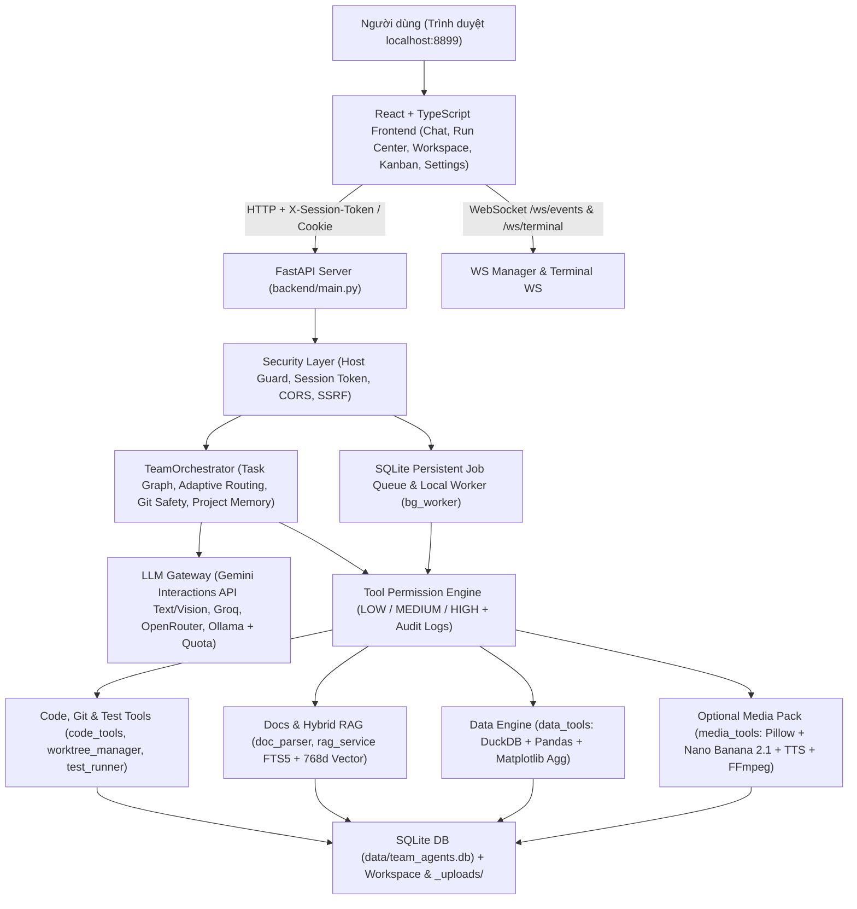
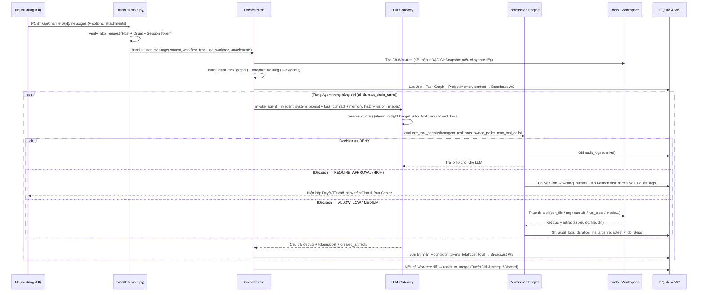

# 📘 ARCHITECTURE & ENGINEERING GUIDE — `Team AI Studio` (`Team-Agents`)

> **Mục đích tài liệu:** Sổ tay kỹ thuật toàn diện ghi lại toàn bộ kiến trúc hệ thống, vai trò từng file, cơ chế phân quyền 5 Agent × 26 Tools, luồng xử lý End-to-End, thiết kế cơ sở dữ liệu SQLite, các cơ chế bảo mật và toàn bộ nội dung triển khai từ **Phase 0 → Phase 4**, giúp bạn dễ dàng mở ra đọc, nghiên cứu, bảo trì hoặc mở rộng dự án sau này.

---

## 1. Triết lý Kiến trúc & Định vị Hệ thống

`Team AI Studio` được thiết kế theo triết lý **Local-First AI Engineering Workspace (Chuẩn thực chiến ≤ 4 sao)**:

1. **Không phụ thuộc hạ tầng nặng:** Chạy mượt ngay trên Windows cá nhân với Python `.venv` + SQLite duy nhất (không bắt buộc Docker, Redis, Postgres hay Vector DB rời), nhưng **sẵn sàng chạy trên Docker** qua `docker compose up --build` bất cứ khi nào cần cô lập OS hoặc cần sẵn `ffmpeg`.
2. **LLM đề xuất — Backend kiểm soát:** Mọi hành động của AI (sửa file, chạy lệnh, gọi HTTP, chạy script phân tích, xử lý FFmpeg) đều đi qua **Tool Permission Engine 3 cấp (`LOW` / `MEDIUM` / `HIGH`)** thực thi ở tầng backend, ghi **Audit Log** và có cơ chế **Duyệt (Human Approval)** + **Hoàn tác (Git Worktree / Snapshot Rollback)**.
3. **3 Trụ cột cốt lõi + 1 Module tùy chọn:**
   - **AI Software Development:** Đọc/tìm codebase, sửa từng đoạn theo SHA-256, chạy test tự động, duyệt Diff & Merge/Rollback, Live Web Preview.
   - **AI Research Assistant:** Đọc trực tiếp PDF/Word/Excel, Local Hybrid RAG (FTS5 BM25 + Embedding 768d) có bằng chứng & trích dẫn, xuất báo cáo Word `.docx`.
   - **AI Data Analyst & Visual Debugging:** Profiling dataset, truy vấn SQL DuckDB an toàn, chạy script Matplotlib xuất biểu đồ inline, và Multimodal Vision đọc ảnh chụp màn hình.
   - **Optional Media & Workflow Pack:** Chỉnh sửa ảnh Pillow, tạo ảnh Gemini Nano Banana 2.1, tạo giọng đọc Gemini 3.8 TTS, FFmpeg có cấu trúc và Workflow Templates.

---

## 2. Sơ Đồ Kiến Trúc & Luồng Xử Lý End-to-End

### 2.1. Kiến trúc tổng thể hệ thống

### 2.2. Luồng thực thi một yêu cầu từ khung Chat (Sequence Flow)

---

## 3. Lịch Sử & Chi Tiết Toàn Bộ Các Giai Đoạn (Phase 0 → Phase 4)

### Đợt tiền đề: Kiểm duyệt & Vá lỗi toàn diện (Hardening Pass)
- **Bảo mật nền:** Bắt buộc `X-Session-Token` / cookie `crew_session` vô điều kiện trên mọi API nhạy cảm; thêm `is_allowed_host()` chống DNS Rebinding; chặn SSRF trên `OLLAMA_BASE_URL`; chặn đổi workspace vào thư mục gốc `ROOT_DIR`, `backend/`, `data/`, hoặc thư mục hệ thống.
- **Ổn định Windows & Async:** Thêm `kill_process_tree()` (`taskkill /PID ... /T /F`) diệt sạch cây tiến trình con; tách runner task trong `terminal_ws.py` để nút **Stop (`kill`)** dừng ngay lệnh đang chạy giữa chừng; chuyển Git subprocess & I/O nặng sang `asyncio.to_thread`; dùng `BEGIN IMMEDIATE` chống khóa SQLite; thêm lượt tổng hợp cuối khi chạm trần `max_tool_rounds`.
- **Frontend Resilience:** Sửa lỗi lưu API Key tự bật lại Demo Mode, thêm request guard chống race condition khi chuyển kênh/file nhanh, auto-reconnect backoff cho `/ws/events` và `/ws/terminal`.

### Phase 0: Nền tảng Tin cậy, Bảo mật & Điều phối Công việc
- **Vấn đề giải quyết:** Ngăn AI vượt quyền, lặp vô hạn, gọi thừa cả 5 agent cho tác vụ nhỏ, hoặc làm mất tiến trình nền khi khởi động lại server.
- **Thành phần chính:**
  - `backend/permission_engine.py`: Phân quyền cứng 3 cấp `LOW` / `MEDIUM` / `HIGH`, kiểm tra `allowed_tools` theo Agent ∩ `Task Contract`, kiểm tra `owned_paths` (chuẩn hóa `posixpath.normpath` chặn traversal `..` và chuẩn hóa đuôi file `.docx`/`.png`/`.wav`), kiểm tra `max_tool_calls`, tự ẩn trường nhạy cảm (`api_key`, `token`, `password`, `authorization`, `cookie`) trước khi ghi bảng `audit_logs`.
  - `backend/orchestrator.py`: `build_initial_task_graph()` sinh danh sách **Task Contract** (`task_id`, `agent_id`, `objective`, `dependencies`, `owned_paths`, `allowed_tools`, `acceptance_criteria`, `max_tool_calls`, `max_tokens`, `status`) kết hợp **Adaptive Routing** (ví dụ `bugfix` chạy gọn `Kiên → Bình`; `review` chạy 1 mình `Bình`; `@Tên` chỉ gọi đúng người được nhắc).
  - `backend/job_worker.py`: Hàng đợi bền vững `background_jobs` trên SQLite (claim atomic bằng `BEGIN IMMEDIATE`), tự đánh dấu `interrupted` khi server khởi động lại, hỗ trợ `Retry`/`Cancel` và phát tiến độ realtime qua sự kiện WebSocket `bg_job_updated`.
  - `backend/config.py`: Hỗ trợ tách khóa bí mật sang vùng tách biệt ngoài thư mục dự án (`%LOCALAPPDATA%\CrewStudio\secrets.env` trên Windows hoặc `/app/data/secrets.env` trong Docker) qua `get_secret_storage_info()` và `migrate_secrets_to_isolated_store()`.

### Phase 1: AI Coding Workspace, Git Safety, Automated Test Runner & Project Memory
- **Vấn đề giải quyết:** Loại bỏ nhược điểm phải ghi đè toàn bộ file code dài, thêm lưới an toàn hoàn tác Git, vòng lặp tự chạy test sửa lỗi và trí nhớ dài hạn giữa các phiên làm việc.
- **Thành phần chính:**
  - `backend/code_tools.py`:
    - `edit_workspace_file_checked()` (`edit_file`): Kiểm tra `expected_sha256`, yêu cầu `old_text` khớp **duy nhất 1 vị trí**, ghi atomic qua temp file + `os.replace`, trả unified diff.
    - `read_workspace_lines()` (`read_file_lines`): Đọc từng vùng dòng (tối đa 400 dòng/lần) kèm `sha256` để truyền thẳng vào `edit_file`.
    - `grep_workspace()` (`grep_search`): Tìm regex toàn dự án, tự bỏ qua `.git`, `node_modules`, `.venv`, file nhị phân và symlink ngoài.
    - `inspect_sqlite_readonly()` (`inspect_sqlite`): Mở SQLite chế độ chỉ đọc tuyệt đối (`?mode=ro` + `PRAGMA query_only=ON`).
    - `safe_http_request()` (`http_request`): Cho phép test API trên `localhost` (cấm tự gọi cổng Crew Studio `8899`!), chặn IP metadata `169.254.*` & LAN riêng; truy cập domain công khai đòi duyệt cấp `HIGH`.
  - `backend/worktree_manager.py`: Bổ sung `create_git_snapshot()`, `get_snapshot_diff()`, và `rollback_to_snapshot()` (dùng ref `refs/crew-snapshots/run-*`, chỉ xóa file untracked sinh mới sau snapshot, bảo toàn tuyệt đối file untracked cũ của người dùng).
  - `backend/test_runner.py`: Tự phát hiện `python-unittest`, `python-pytest`, `ts-typecheck`, `npm-test`, thực thi bằng `create_subprocess_exec` (không `shell=True`) gắn **Windows Job Object** (`JOB_OBJECT_LIMIT_KILL_ON_JOB_CLOSE`).
  - `backend/project_memory.py`: Lưu tri thức dự án (`profile`, `architecture`, `completed_task`, `known_issue`, `code_ref`) kèm `source_ref` + `source_sha256`; hàm `verify_workspace_memory()` tự đánh dấu `stale` nếu file nguồn đổi hash hoặc bị xóa.
  - **Upload & Web Preview cô lập:** `POST /api/files/upload` (hỗ trợ cả `multipart/form-data` không cần `python-multipart` lẫn raw body, giới hạn 50MB, lưu vào `workspace/_uploads/`), `GET /api/files/raw` (kèm `nosniff` và CSP `sandbox` cho `.svg`), `GET /api/files/preview` (CSP `connect-src 'none'`) kết hợp `<iframe sandbox="allow-scripts">` (cấm `allow-same-origin`) trên `ArtifactDrawer.tsx`.

### Phase 2: Document Intelligence & Local Hybrid RAG
- **Vấn đề giải quyết:** Đọc trực tiếp tài liệu văn phòng (PDF/Word/Excel), xử lý kho tài liệu/code lớn không tràn context và chống bịa đặt thông tin.
- **Thành phần chính:**
  - `backend/doc_parser.py`:
    - Đọc `.pdf` (`pypdf`, theo trang `p.N`, tự phát hiện PDF scan khi trung bình < 30 ký tự/trang), `.docx` (`python-docx`, giữ heading & bảng Markdown), `.xlsx`/`.xlsm` (`openpyxl`, đọc theo sheet & nhóm 40 dòng), Markdown & code.
    - `export_docx_report()`: Chuyển báo cáo Markdown sang file Word `.docx` chuẩn trình bày và lưu atomic.
  - `backend/rag_service.py`:
    - Lưu ngay trong SQLite qua 3 bảng `rag_documents`, `rag_chunks`, `rag_chunks_fts` (FTS5 `unicode61`), đồng bộ delete/insert tường minh tránh lệch chỉ mục.
    - **Embedding 768 chiều (MRL):** Ưu tiên `gemini-embedding-001` (`output_dimensionality=768` tiết kiệm ~4 lần RAM so với 3072d) → fallback Ollama `nomic-embed-text` → fallback FTS5 offline 100%.
    - **Hybrid Search + RRF:** Làm sạch truy vấn FTS5 chống lỗi cú pháp (`C++`, `foo.bar()`, `@Minh`), kết hợp BM25 và NumPy cosine similarity theo công thức Reciprocal Rank Fusion (`0.55/(60+r_bm25) + 0.45/(60+r_vec)`).
    - **Evidence Gate & Benchmark:** Trả `evidence_found: False` khi không có bằng chứng, bọc snippet trong `<retrieved_context trust="untrusted">`, và cung cấp `benchmark_rag()` đo `Recall@K`, `MRR`, `avg/p95 latency_ms`.

### Phase 3: Data Analysis Engine & Multimodal Vision Debugging
- **Vấn đề giải quyết:** Cho phép Agent phân tích dataset vài trăm nghìn dòng không tràn token, vẽ biểu đồ trực quan hiển thị ngay trong chat, và "nhìn" ảnh chụp màn hình lỗi giao diện/sơ đồ.
- **Thành phần chính:**
  - `backend/data_tools.py`:
    - `profile_dataset()`: Quét `.csv`, `.tsv`, `.xlsx`, `.xlsm`, `.parquet`, `.json`, `.jsonl` trả bản hồ sơ gọn (~500 tokens: số dòng/cột, danh sách sheet Excel, `null_pct`, `unique_count`, `min/max/mean/median`, top 3 giá trị, 5 dòng mẫu).
    - `query_dataset_sql()`: Nạp bảng `data` trên DuckDB in-memory (hỗ trợ `read_xlsx` + fallback `openpyxl`), **khóa cứng `SET enable_external_access = false;`** trước khi chạy SQL của LLM/User để chặn tuyệt đối đọc file ngoài workspace; hỗ trợ xuất kết quả ra `.csv`/`.xlsx`/`.parquet`/`.json`.
    - `run_data_script()`: Chạy script Python (`MPLBACKEND=Agg`, Windows Job Object, yêu cầu duyệt cấp `HIGH`), tự quét và đính kèm mọi biểu đồ `.png`/`.svg` và bảng dữ liệu vừa tạo vào `created_artifacts`.
  - **Multimodal Vision (`backend/llm_gateway.py` + `ChatArea.tsx`):** Tự thu thập tối đa 4 ảnh (≤ 6MB/ảnh) từ file đính kèm trong tin nhắn gần nhất, gửi chuẩn Interactions API `{"type": "image", "data": base64, "mime_type": ...}` cho Gemini và `image_url` cho OpenAI-compat (có tự động fallback text-only nếu provider trả 400/422). Trên giao diện `WorkspacePanel.tsx` có sẵn **Dataset Inspector** (chọn sheet Excel, xem schema, chạy SQL DuckDB trực tiếp).

### Phase 4: Optional Media Pack & Workflow Templates
- **Vấn đề giải quyết:** Đáp ứng tác vụ tạo/xử lý ảnh, tạo giọng đọc thuyết minh, thao tác video ngắn FFmpeg ở mức tùy chọn (không làm nặng lõi) và tái sử dụng nhanh các quy trình làm việc lặp lại.
- **Thành phần chính:**
  - `backend/media_tools.py`: `transform_image` (Pillow cục bộ: `resize`, `crop`, `convert`, `thumbnail`, `watermark`, `grid`), `generate_image` (Gemini Nano Banana 2.1), `generate_speech_tts` (Gemini 3.8 Flash TTS xuất `.wav`), và `process_media_ffmpeg` (5 thao tác có cấu trúc `trim`, `compress`, `extract_audio`, `burn_subtitles`, `slideshow`, tự kiểm tra có `ffmpeg` hay không).
  - `backend/workflow_templates.py`: Bảng `workflow_templates` với 5 mẫu chuẩn thực chiến sẵn có + CRUD tạo/xóa mẫu riêng + API chạy mẫu 1 click (`POST /api/templates/{id}/run`).
  - **Giao diện Media & Templates:** `ArtifactDrawer.tsx` phát trực tiếp `<audio>` & `<video>`, `ChatArea.tsx` phát Audio inline & popup chọn **Mẫu quy trình**, `RunCenterPanel.tsx` có tab **Media & Templates**.

---

## 4. Vai Trò Chi Tiết Từng File Trong Dự Án

### 4.1. Backend (`backend/`) — 21 files Python

| File | Vai trò cốt lõi |
| :--- | :--- |
| `backend/main.py` | Điểm vào FastAPI: `lifespan` khởi chạy `bg_worker` (đăng ký `run_tests`, `rag_index`, `data_script`, `media_ffmpeg`), toàn bộ REST API, WebSocket `/ws/events` & `/ws/terminal`, và serve SPA `frontend/dist`. |
| `backend/config.py` | Đường dẫn dự án (`ROOT_DIR`, `DB_PATH`, `ENV_PATH`), `MODEL_CATALOG`, tính chi phí `estimate_cost_usd`, và quản lý vùng lưu bí mật tách biệt `secrets.env`. |
| `backend/security.py` | Sinh `SESSION_TOKEN`, `is_allowed_host()` chống DNS Rebinding, `verify_http_request()`, `verify_websocket_auth()`, và `build_sanitized_subprocess_env()`. |
| `backend/models.py` | Toàn bộ Pydantic request/response schemas với validation `Literal` và giới hạn biên số học. |
| `backend/database.py` | Kết nối SQLite WAL (`PRAGMA busy_timeout=15000`), additive migrations an toàn và CRUD cho toàn bộ bảng lõi. |
| `backend/permission_engine.py` | Bộ máy phân quyền Tool 3 cấp (`LOW`/`MEDIUM`/`HIGH`), `TOOL_CATALOG` 26 tools, `DEFAULT_ROLE_TOOLS`, `is_path_within_owned`, `redact_arguments`, `record_audit_event`. |
| `backend/orchestrator.py` | `TeamOrchestrator`: quản lý `handle_user_message`, `build_initial_task_graph`, Adaptive Routing, Git Snapshot/Worktree, `approve_run` (question/shell/tool_approval), `resume_run`, `stop_run`, `ask_teammate`. |
| `backend/llm_gateway.py` | Cổng gọi LLM hợp nhất (`_call_gemini` Interactions API hỗ trợ Multimodal Vision + thinking tokens, `_call_openai_compat` cho Groq/OpenRouter/Ollama), `reserve_quota` atomic, `max_tool_rounds` final synthesis và auto-fallback. |
| `backend/tools.py` | Khai báo `AGENT_TOOLS_SPEC` (26 tools), helper `_resolve_safe_path` (chặn symlink/junction/ADS/reserved names), `kill_process_tree`, và `ToolExecutionContext.execute()`. |
| `backend/code_tools.py` | Thực thi `edit_workspace_file_checked` (SHA-256 + unique match + diff), `read_workspace_lines`, `grep_workspace`, `inspect_sqlite_readonly`, `safe_http_request`. |
| `backend/worktree_manager.py` | Quản lý Git Worktree (`create`, `diff`, `merge`, `discard`) và Git Snapshot/Rollback (`create_git_snapshot`, `get_snapshot_diff`, `rollback_to_snapshot`), luôn bật `-c core.quotePath=false` cho tiếng Việt. |
| `backend/test_runner.py` | Tự phát hiện & chạy test (`unittest`, `pytest`, `tsc`, `npm test`) bằng `create_subprocess_exec` + Windows Job Object. |
| `backend/project_memory.py` | Ghi nhận, xác minh tính mới (`verify_workspace_memory` đánh dấu `stale`) và dựng `<project_memory>` cho prompt. |
| `backend/job_worker.py` | Worker chạy ngầm đọc hàng đợi SQLite `background_jobs`, hỗ trợ `enqueue`, `retry`, `cancel` và phát tiến độ realtime qua WebSocket. |
| `backend/doc_parser.py` | Bóc tách `.pdf` (kèm phát hiện bản scan), `.docx`, `.xlsx`, Markdown, code và xuất báo cáo `.docx`. |
| `backend/rag_service.py` | Local Hybrid RAG: schema FTS5 + vector 768d, chunking, incremental indexing theo SHA-256, RRF hybrid search, Evidence Gate và `benchmark_rag`. |
| `backend/data_tools.py` | `profile_dataset`, `query_dataset_sql` (DuckDB `enable_external_access=false`, `read_xlsx`/openpyxl fallback) và `run_data_script` (`MPLBACKEND=Agg`, auto-collect charts). |
| `backend/media_tools.py` | Pillow local transforms, Gemini Nano Banana 2.1 image gen, Gemini 3.8 Flash TTS, và FFmpeg structured ops tùy chọn. |
| `backend/workflow_templates.py` | Bảng SQLite `workflow_templates`, 5 mẫu quy trình mặc định và CRUD/render prompt. |
| `backend/ws_manager.py` | Quản lý kết nối `/ws/events` có per-socket `asyncio.Lock` và timeout `3.0s` chống slow-consumer. |
| `backend/terminal_ws.py` | WebSocket `/ws/terminal` chạy lệnh bất đồng bộ tách luồng đọc WS, cho phép `kill` giữa chừng và giải mã UTF-8 incremental. |

### 4.2. Frontend (`frontend/src/`)

| File | Vai trò cốt lõi |
| :--- | :--- |
| `src/types.ts` | Toàn bộ TypeScript interfaces khớp 1-1 với JSON backend (Agents, Runs, Task Graph, Audit Logs, BG Jobs, Memory, RAG, Dataset, Media, Templates). |
| `src/api.ts` | HTTP client tự động lấy & làm mới `X-Session-Token` (retry 401), giải mã lỗi FastAPI tiếng Việt, `uploadFile` (`FormData`), `rawFileUrl`, `previewFileUrl`, `wsUrl`. |
| `src/App.tsx` | State trung tâm, nạp dữ liệu an toàn bằng `Promise.allSettled`, quản lý `/ws/events` (reconnect exponential backoff) và đồng bộ realtime `messages`, `runs`, `tasks`, `bgJobs`, `usage`. |
| `src/components/Sidebar.tsx` | Thanh điều hướng trái: Phòng họp chung, danh sách Chat 1-1 với từng Agent, chuyển tab (Hội thoại, Run Center, Kanban, Workspace, Quota) và chọn dự án. |
| `src/components/ChatArea.tsx` | Khung hội thoại chính: chọn Workflow, bật Worktree, popup chọn **Mẫu quy trình**, đính kèm upload file (kèm thumbnail `Vision`), render inline **Ảnh/Biểu đồ/Audio**, và hộp phê duyệt inline (`question`/`shell`/`tool_approval`). |
| `src/components/RunCenterPanel.tsx` | Bảng điều khiển Run trung tâm với 7 sub-tabs: `Timeline`, `Diff` (Merge/Discard), `Audit Log`, `Tests & Plan` (Task Contracts + Chạy Test), `Bộ nhớ dự án`, `Kho tri thức (RAG)`, `Media & Templates`, nút `Hoàn tác (Rollback)` và thanh `Background Jobs`. |
| `src/components/WorkspacePanel.tsx` | Cây file dự án, trình sửa code, **Dataset Inspector + DuckDB SQL** cho CSV/Excel/Parquet, xem trước ảnh/PDF/Word và **Terminal WebSocket** tích hợp (auto-reconnect + nút Stop tức thời). |
| `src/components/ArtifactDrawer.tsx` | Ngăn xem chi tiết tài liệu: Markdown preview, sửa code, xem Ảnh, nhúng PDF, phát Audio/Video và **Live HTML Preview** trong iframe cô lập `sandbox="allow-scripts"`. |
| `src/components/KanbanPanel.tsx` | Bảng quản lý công việc 5 cột (`todo`, `working`, `needs_you`, `in_review`, `done`). |
| `src/components/QuotaPanel.tsx` | Theo dõi request, token, chi phí ước tính, cấu hình giới hạn ngày và nút **Tạm dừng khẩn cấp (Pause All)**. |
| `src/components/SettingsModal.tsx` | Cấu hình API keys + tách khóa bí mật `secrets.env`, tùy chỉnh từng Agent (model, prompt, bảng bật/tắt **26 Allowed Tools**) và cấu hình chung. |
| `src/components/WorkspaceSwitcherModal.tsx` | Duyệt thư mục, chuyển dự án làm việc và bật/tắt khóa thư mục Terminal. |

---

## 5. Đội Ngũ 5 Agent Mặc Định & Ma Trận 26 Tools

### 5.1. Vai trò 5 Agent mặc định (`DEFAULT_AGENTS`)

| ID | Tên | Vai trò | Nhiệm vụ điển hình |
| :--- | :--- | :--- | :--- |
| `leader` | **Minh** 🧭 | Team Leader & Điều phối | Phân tích yêu cầu, lập kế hoạch, chia task Kanban, hỏi xác nhận `ask_human`, điều phối `@Tên`. |
| `research` | **An** 🔎 | Nghiên cứu & Chiến lược | Đọc PDF/Word/Excel, tra cứu RAG, phân tích dataset bằng SQL, viết spec & xuất báo cáo Word `.docx`. |
| `content` | **Linh** ✍️ | Nội dung & Marketing | Viết kịch bản, nội dung chiến dịch, tài liệu Markdown/Word, tạo ảnh minh họa & giọng đọc TTS. |
| `coder` | **Kiên** 💻 | Lập trình & Kỹ thuật | Toàn quyền coding (`edit_file`, `grep_search`, `run_tests`, `http_request`, `inspect_sqlite`, `run_data_script`, `run_shell_command`, media). |
| `reviewer` | **Bình** 🛡️ | Kiểm tra & Đánh giá (QA) | Rà soát code/tài liệu, kiểm tra bảo mật/logic, chạy `run_tests`, soi dữ liệu và đối chiếu tiêu chí nghiệm thu. |

### 5.2. Ma trận phân quyền 26 Tools theo 3 cấp rủi ro (`permission_engine.py`)

| Cấp rủi ro | Cơ chế thực thi ở Backend | Danh sách Tools |
| :--- | :--- | :--- |
| 🟢 **LOW** *(9 tools)* | Tự động chạy (chỉ đọc, không thay đổi trạng thái) | `list_files`, `read_file`, `read_file_lines`, `grep_search`, `inspect_sqlite`, `project_memory_read`, `read_document`, `search_knowledge`, `profile_dataset` |
| 🔵 **MEDIUM** *(13 tools)* | Cho phép trong phạm vi `allowed_tools` & `owned_paths` của Workspace/Worktree | `write_file`, `edit_file`, `create_task`, `ask_human`, `ask_teammate`, `run_tests`, `project_memory_write`, `export_docx_report`, `query_dataset_sql`, `transform_image`, `generate_image`, `generate_speech_tts`, `http_request` *(tới `localhost` khác cổng Crew Studio)* |
| 🔴 **HIGH** *(4 tools + ngữ cảnh nâng cấp)* | **Bắt buộc Human Approval** (tạm dừng Run sang `waiting_human`) hoặc **Deny** nếu khớp mẫu nguy hiểm | `delete_file`, `run_shell_command` *(lệnh nhạy cảm / cài gói / interpreter)*, `http_request` *(ra domain công khai)*, `run_data_script`, `process_media_ffmpeg` |

---

## 6. Sơ Đồ Cơ Sở Dữ Liệu SQLite (`data/team_agents.db`)

Hệ thống dùng **1 file SQLite duy nhất** chạy ở chế độ `WAL` (`journal_mode=WAL`, `busy_timeout=15000`) gồm **16 bảng** (mọi nâng cấp đều là additive migration an toàn):

- **Nhóm Hội thoại & Đội ngũ (4 bảng):** `agents` (kèm `allowed_tools_json`), `channels`, `messages` (kèm `artifacts_json`, `tool_calls_json`, token/cost), `tasks` (Kanban).
- **Nhóm Điều phối & Giám sát Run (4 bảng):** `jobs` (kèm `task_graph_json`, `snapshot_ref`, `worktree_path`, `tokens_total`, `cost_total`, `test_summary_json`), `job_steps`, `audit_logs`, `usage_logs`.
- **Nhóm Hạ tầng Nền, Bộ nhớ & Upload (4 bảng):** `app_settings`, `background_jobs` (hàng đợi worker bền vững), `project_memory` (kèm `source_ref`, `source_sha256`, `status`), `uploads` (quản lý file trong `_uploads/`).
- **Nhóm Local Hybrid RAG (3 bảng):** `rag_documents`, `rag_chunks` (lưu `embedding_blob` float32 768d), `rag_chunks_fts` (bảng ảo FTS5 `unicode61`).
- **Nhóm Tự động hóa (1 bảng):** `workflow_templates` (5 mẫu mặc định + mẫu người dùng tự tạo).

---

## 7. Tổng Hợp Các Lớp Bảo Mật Đã Áp Dụng

1. **Chống truy cập trái phép & DNS Rebinding (`security.py`):** Mọi API nghiệp vụ (cả `GET` nhạy cảm lẫn `POST`/`PATCH`/`DELETE`) và WebSocket đều bắt buộc kiểm tra `Host` (`localhost`/`127.0.0.1`/`[::1]`), `Origin`, `Sec-Fetch-Site`, và so khớp hằng thời gian `secrets.compare_digest` với `SESSION_TOKEN` (qua header `X-Session-Token` hoặc cookie `HttpOnly; SameSite=Strict`).
2. **Cách ly đường dẫn & File hệ thống (`tools.py`, `main.py`):** Kiểm tra `Path.is_relative_to`, chặn symlink & Windows NTFS Junction trỏ ra ngoài, chặn NTFS ADS (`:`) và tên thiết bị Windows (`CON`, `NUL`, `COM1`...), cấm đổi Workspace vào `ROOT_DIR`, `backend/`, `data/`, hoặc thư mục hệ thống.
3. **Chống SSRF & Tự gọi nội bộ (`main.py`, `permission_engine.py`, `code_tools.py`):** Kiểm tra `OLLAMA_BASE_URL` mặc định chỉ cho loopback; `http_request` cấm gọi cổng nội bộ Crew Studio (`8899`), cấm IP metadata (`169.254.169.254`) và dải LAN nội bộ (`10.*`, `172.16-31.*`, `192.168.*`).
4. **Cách ly dữ liệu & thực thi (`data_tools.py`, `media_tools.py`, `test_runner.py`, `main.py`):**
   - DuckDB chạy `SET enable_external_access = false;` sau khi nạp bảng an toàn.
   - Subprocess chạy bằng `create_subprocess_exec` (tránh `shell=True`), xóa toàn bộ API keys qua `build_sanitized_subprocess_env()`, gắn Windows Job Object + `kill_process_tree`.
   - Web Preview chạy trong `<iframe sandbox="allow-scripts">` (không `allow-same-origin`) + header `Content-Security-Policy: ... connect-src 'none'`; file `.svg` trên `/api/files/raw` gắn `Content-Security-Policy: default-src 'none'; ... sandbox;`.
   - Container Docker chạy bằng non-root user `crewuser`, bind cổng duy nhất về `127.0.0.1`, bật `no-new-privileges:true`, không đóng gói `.env` hay DB vào image (`.dockerignore`).

---

## 8. Hướng Dẫn Mở Rộng Sau Này (Developer Cheat Sheet)

1. **Thêm một Tool mới cho Agent:**
   - Khai báo metadata & mức rủi ro (`LOW`/`MEDIUM`/`HIGH`) tại `TOOL_CATALOG` và `DEFAULT_ROLE_TOOLS` trong `backend/permission_engine.py`.
   - Thêm JSON schema cho LLM tại `AGENT_TOOLS_SPEC` và nhánh xử lý tại `ToolExecutionContext._execute_allowed` trong `backend/tools.py`.
   - Viết 1 unit test trong `backend/tests/test_security_and_core.py`.
2. **Thêm một Background Job loại mới:**
   - Đăng ký handler bất đồng bộ `bg_worker.register_handler("my_job_type", _handle_my_job)` bên trong `lifespan` của `backend/main.py` và gọi `await bg_worker.enqueue(...)`.
3. **Đo chất lượng RAG trên tập tài liệu riêng của bạn:**
   - Gọi `benchmark_rag(workspace, eval_cases=[{"query": "...", "expected_path": "..."}], top_k=5)` trong `backend/rag_service.py` để đo `recall_at_k`, `mrr` và độ trễ thực tế trước khi điều chỉnh `max_chars` chunking hoặc bật thêm reranker.
4. **Nâng cấp chạy thực tế trên Docker vs Windows:**
   - **Windows trực tiếp (`start.bat`):** Tốt nhất khi cần trỏ Workspace vào nhiều thư mục dự án khác nhau trên ổ `C:\`/`D:\` và chạy terminal PowerShell trực tiếp.
   - **Docker (`docker compose up --build -d`):** Tốt nhất khi muốn cô lập tiến trình agent trong container Linux non-root và có sẵn **FFmpeg** cài đặt tự động.
