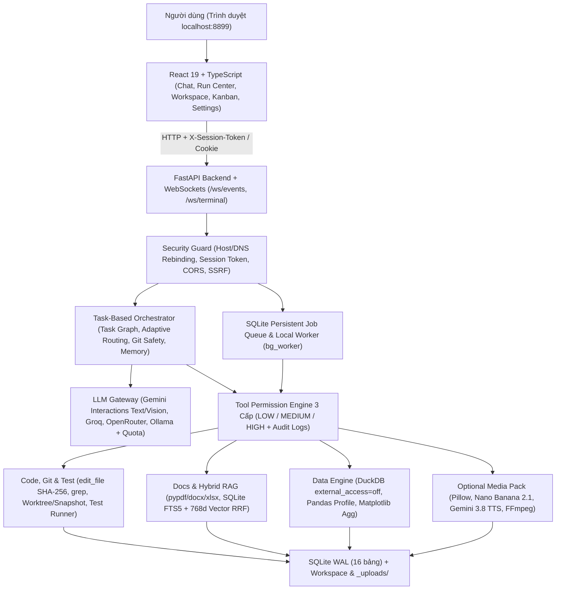
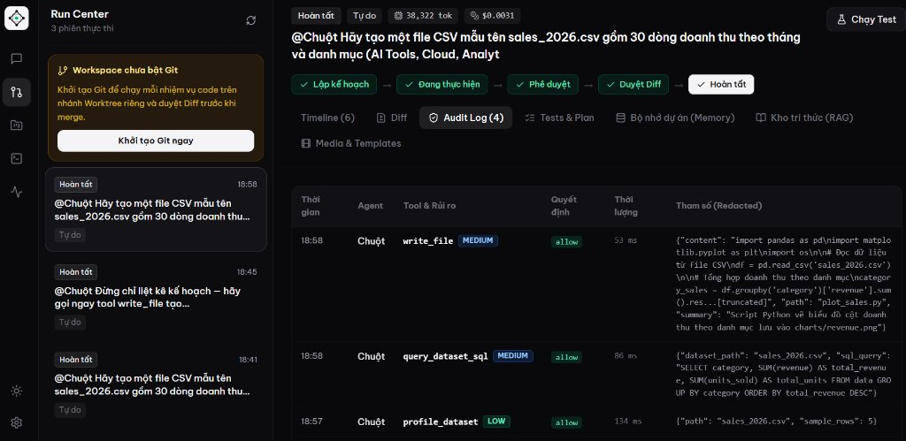
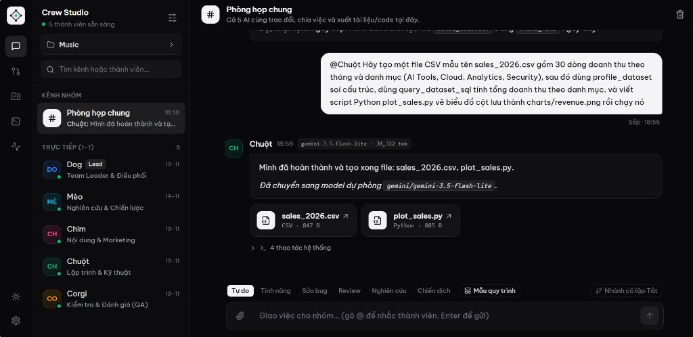
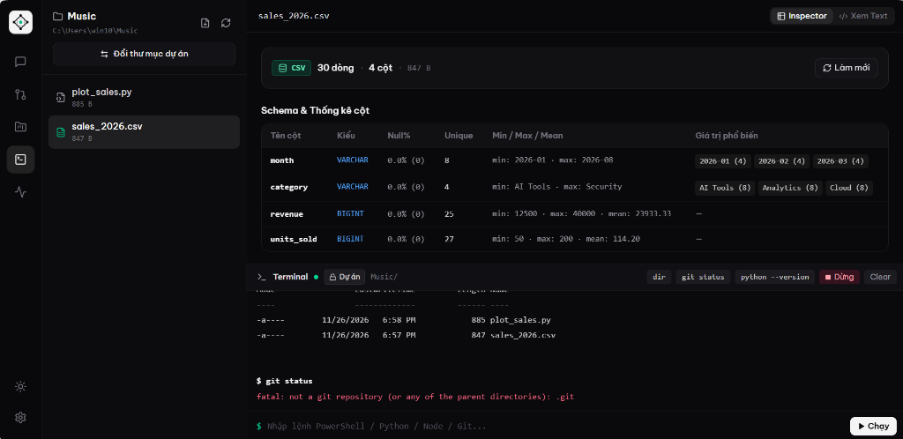
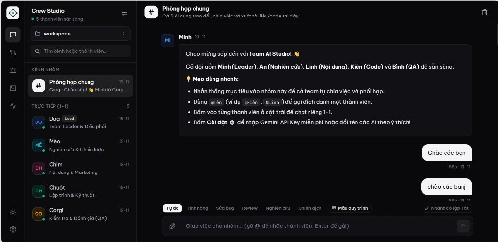
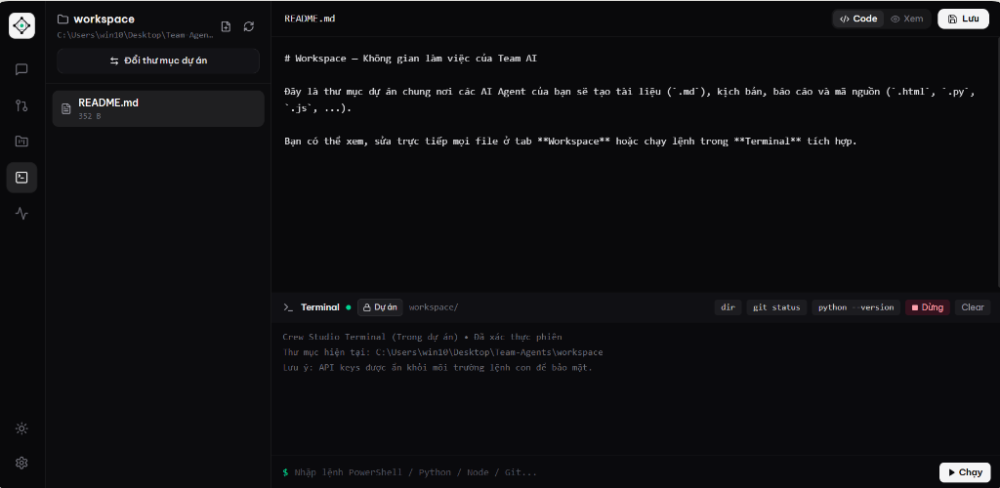
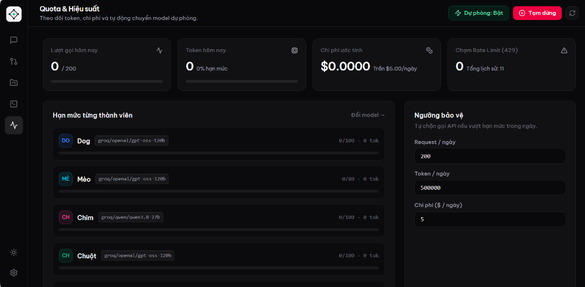

# 🚀 DevAgent Studio (Team AI Studio)

**Local-First Multi-Agent AI Engineering Workspace**
*Phối hợp 5 AI Agent cho Lập trình, Hybrid RAG (PDF/Word/Excel), Phân tích dữ liệu DuckDB, Multimodal Vision & Bảo mật thực thi 3 cấp.*

[📘 Kiến trúc chi tiết (`ARCHITECTURE.md`)](./ARCHITECTURE.md) · [✨ Danh mục Tính năng (`FEATURES.md`)](./FEATURES.md) · [📝 Lịch sử Phiên bản (`CHANGELOG.md`)](./CHANGELOG.md)

---

> [!NOTE]
> **Về repository này:** Đây là trang **trưng bày kiến trúc, thiết kế hệ thống và demo** của dự án **DevAgent Studio**. Toàn bộ mã nguồn sản phẩm được quản lý tại repository **Private** (*All Rights Reserved*).

---

## 🎯 Bài toán giải quyết

Thay vì dừng ở một giao diện "nhiều AI chat qua lại với nhau", **DevAgent Studio** được thiết kế như một **AI Engineering Workspace chạy cục bộ (Local-First)** — không bắt buộc Docker hay Database rời (nhưng hỗ trợ đóng gói Docker đầy đủ) — giải quyết trọn vẹn 3 trụ cột công việc kỹ thuật hằng ngày với **khả năng kiểm soát, kiểm thử và hoàn tác (rollback)**:

| Trụ cột | Năng lực cốt lõi |
| :--- | :--- |
| **💻 AI Software Development** | • Điều phối theo **Task Graph + Task Contract** & **Adaptive Routing** (tác vụ nhỏ chỉ gọi 1–2 Agent). • Sửa code an toàn từng đoạn bằng `edit_file` kiểm tra **`expected_sha256`**, khớp duy nhất & trả unified diff. • **Git Worktree + Diff Review + Merge/Discard** và **Git Snapshot & Rollback** 1 click. • **Automated Test Runner** (`unittest`/`pytest`/`tsc`/`npm test`) gắn Windows Job Object, **Project Memory** tự phát hiện dữ liệu lỗi thời (`stale`), và **Live Web Preview** cô lập CSP. |
| **📚 Document Intelligence & Hybrid RAG** | • Đọc trực tiếp `.pdf` (kèm phát hiện PDF scan), `.docx`, `.xlsx`, Markdown, mã nguồn và xuất báo cáo Word `.docx`. • **Local Hybrid RAG trên SQLite:** kết hợp **SQLite FTS5 (BM25)** + **Vector Embedding 768 chiều (MRL)** (`gemini-embedding-001` → Ollama → FTS5 offline), hợp nhất **Reciprocal Rank Fusion (RRF)**. • **Evidence Gate** chống bịa đặt, bọc `<retrieved_context trust="untrusted">` và bộ benchmark đo `Recall@K`, `MRR`, latency. |
| **📊 Data Analytics & Multimodal Vision** | • **Dataset Inspector & DuckDB SQL:** soi cấu trúc `.csv`/`.xlsx`/`.parquet`/`.jsonl` gọn nhẹ (~500 tokens), chạy SQL tốc độ cao với **`SET enable_external_access = false;`** chống đọc file ngoài workspace. • Chạy script phân tích & vẽ biểu đồ **Matplotlib (`Agg`)** tự động hiển thị ảnh biểu đồ inline ngay trong khung chat. • **Multimodal Vision:** đính kèm ảnh chụp màn hình lỗi UI / sơ đồ kiến trúc để Agent nhìn trực tiếp và sửa code. |
| **🎬 Optional Media & Automation** | • Chỉnh sửa/nén/ghép ảnh cục bộ bằng **Pillow**, tạo ảnh AI (**Gemini Nano Banana 2.1**), tạo giọng đọc WAV (**Gemini 3.8 Flash TTS**), tác vụ **FFmpeg có cấu trúc** (tự động nhận diện) và **Workflow Templates** khởi chạy 1 click. |

---

## 🏗️ Kiến Trúc Tổng Thể Hệ Thống

> 👉 Xem sơ đồ tuần tự (Sequence Diagram), vai trò chi tiết 21 module Backend + 12 module Frontend và cấu trúc 16 bảng SQLite tại **[ARCHITECTURE.md](./ARCHITECTURE.md)**.

---

## 🤖 Đội Ngũ 5 Agent & Ma Trận 26 Tools

| Agent | Vai trò | Phạm vi công cụ tiêu biểu |
| :--- | :--- | :--- |
| 🧭 **Minh** (`leader`) | Team Leader & Điều phối | Lập kế hoạch, Task Graph, Kanban, `ask_human`, đọc tài liệu/RAG, báo cáo Word |
| 🔎 **An** (`research`) | Nghiên cứu & Chiến lược | `read_document`, `search_knowledge`, `profile_dataset`, `query_dataset_sql`, `export_docx_report` |
| ✍️ **Linh** (`content`) | Nội dung & Truyền thông | Soạn thảo Markdown/Word, tra cứu RAG, `generate_image`, `transform_image`, `generate_speech_tts` |
| 💻 **Kiên** (`coder`) | Kỹ sư Full-Stack & Data | Toàn bộ nhóm Coding (`edit_file`, `grep_search`, `run_tests`, `inspect_sqlite`, `http_request`), `run_data_script`, `run_shell_command`, Media |
| 🛡️ **Bình** (`reviewer`) | QA & Security Reviewer | Rà soát code/diff, `grep_search`, `run_tests`, `inspect_sqlite`, kiểm chứng dữ liệu & bảo mật |

### Cơ chế phân quyền 3 cấp thực thi cứng ở Backend

| Cấp độ | Chính sách thực thi | Ví dụ Tools |
| :--- | :--- | :--- |
| 🟢 **LOW** *(9 tools)* | Tự động thực thi (chỉ đọc) | `list_files`, `read_file`, `read_file_lines`, `grep_search`, `inspect_sqlite`, `read_document`, `search_knowledge`, `profile_dataset`, `project_memory_read` |
| 🔵 **MEDIUM** *(13 tools)* | Thực thi trong `allowed_tools` & `owned_paths` của Workspace/Worktree | `edit_file`, `write_file`, `run_tests`, `query_dataset_sql`, `export_docx_report`, `transform_image`, `generate_image`, `generate_speech_tts`, `http_request` *(localhost)* |
| 🔴 **HIGH** *(4 tools)* | **Bắt buộc Human Approval** (tạm dừng Run) + ghi Audit Log | `delete_file`, `run_shell_command` *(nhạy cảm)*, `http_request` *(mạng ngoài)*, `run_data_script`, `process_media_ffmpeg` |

---

## 🛡️ Bảo Mật & Kiểm Chứng Kỹ Thuật

- **Xác thực & Chống tấn công web cục bộ:** Bắt buộc `SESSION_TOKEN` hằng thời gian trên mọi endpoint nhạy cảm & WebSocket, kiểm tra `Host` header chống **DNS Rebinding**, chặn **SSRF** nội bộ/metadata IP (`169.254.169.254`), cô lập **Live Web Preview** bằng `<iframe sandbox="allow-scripts">` (không `allow-same-origin`) + header `Content-Security-Policy: ... connect-src 'none'`.
- **Cô lập dữ liệu & tiến trình:** DuckDB bật `SET enable_external_access = false;`; subprocess dùng `create_subprocess_exec` với env đã xóa API keys + **Windows Job Object** + diệt cây tiến trình `taskkill /T /F`; tùy chọn tách bí mật sang `secrets.env` ngoài thư mục dự án; hỗ trợ **Docker multi-stage non-root**.
- **Kết quả kiểm định tự động:**
  - **47 / 47** bài kiểm thử tự động (`unittest` cô lập trên DB/env tạm) **PASS** — bao phủ Security, Permission Engine, Git Worktree & Rollback, Test Runner, Hybrid RAG, DuckDB Isolation, Vision, Media & Workflow Templates.
  - **Independent QA & Security Audit:** `0` lỗi P0 / P1 / P2.
  - **RAG Benchmark (tập kiểm thử mẫu):** `Recall@5 = 1.0`, `MRR = 1.0`, độ trễ trung bình `~12ms` (SQLite FTS5 + NumPy 768d).

---

## 📸 Giao Diện & Demo Thực Tế

### 1. Run Center — Audit Log 3 Cấp (`LOW / MEDIUM / HIGH`), Timeline & Token/Cost

### 2. Multi-Agent Thực Thi Chuỗi 4 Tool & Tạo File Artifacts Trực Tiếp Trong Chat

### 3. Dataset Inspector (DuckDB Schema, Thống Kê Cột & SQL Trực Tiếp)

### 4. Phòng Họp Chung Multi-Agent, Mẫu Quy Trình & Worktree Cô Lập

### 5. Workspace Editor & Terminal Tích Hợp (Đã Xác Thực Phiên & Ẩn API Keys)

### 6. Bảng Điều Khiển Quota, Hiệu Suất & Tạm Dừng Khẩn Cấp

---

## 🧠 Technical Challenges & Engineering Decisions (Trade-offs)

| Thách thức kỹ thuật | Quyết định kiến trúc & Lý do lựa chọn |
| :--- | :--- |
| **1. Làm sao có Hybrid RAG mạnh mà không bắt người dùng cài Docker / Vector DB rời?** | Kết hợp **SQLite FTS5 (BM25)** có sẵn trong Python với **Embedding 768 chiều (MRL)** lưu dạng `float32` BLOB + tính cosine bằng **NumPy** và hợp nhất **RRF**. Với quy mô cá nhân/repo vừa (< 50.000 chunks), dung lượng RAM chỉ ~146 MiB (thay vì ~586 MiB ở 3072d), vẫn chạy offline 100% bằng FTS5 nếu không có API key. |
| **2. Ngăn LLM ghi đè nhầm code hoặc phá hỏng dự án khi nhiều Agent cùng làm việc?** | Thay vì chỉ có `write_file` ghi đè cả file, triển khai `edit_file(path, old_text, new_text, expected_sha256)` yêu cầu khớp hash SHA-256 + khớp duy nhất 1 vị trí + ghi atomic; kết hợp **Git Worktree** hoặc **Git Snapshot/Rollback** tự động trước mỗi Run. |
| **3. Làm sao cho AI chạy SQL DuckDB trên CSV/Excel nhưng không đọc lén `.env` hay file hệ thống?** | Nạp riêng tệp trong workspace đã qua `_resolve_safe_path` vào bảng in-memory `data` trước, sau đó khóa cứng **`SET enable_external_access = false;`** và chỉ cho phép câu lệnh chỉ đọc (`SELECT`/`WITH`/`SUMMARIZE`) trước khi thực thi truy vấn của Agent. |
| **4. Chặn Prompt Injection từ tài liệu PDF/Word/Web buộc Agent chạy lệnh phá hoại?** | Không dựa vào mỗi System Prompt: mọi lời gọi tool đi qua **Tool Permission Engine 3 cấp** thực thi cứng ở backend (`allowed_tools`, `owned_paths`, `max_tool_calls`, bắt buộc Human Approval cho cấp `HIGH`), ghi **Audit Log** đã ẩn bí mật, và cô lập Web Preview bằng `<iframe sandbox="allow-scripts">` (cấm `allow-same-origin`) + CSP `connect-src 'none'`. |
| **5. Tránh treo Event Loop FastAPI & zombie process trên Windows?** | Đẩy toàn bộ Git subprocess, RAG indexing, DuckDB và tác vụ dài sang **SQLite Persistent Job Queue (`bg_worker`)** & `asyncio.to_thread`; gắn **Windows Job Object** (`KILL_ON_JOB_CLOSE`) + `taskkill /T /F` và tách coroutine đọc WebSocket để nút Stop dừng tiến trình ngay lập tức. |

---

## 🔒 Source Code Availability

**DevAgent Studio** is a privately developed AI engineering project.
This public repository serves as a **technical portfolio and product showcase**, featuring system architecture ([ARCHITECTURE.md](./ARCHITECTURE.md)), feature status ([FEATURES.md](./FEATURES.md)), release history ([CHANGELOG.md](./CHANGELOG.md)), engineering decisions, and UI demonstrations.

The implementation source code is maintained in a **private repository** and is not publicly distributed (**Copyright © 2026 QuanDang317 — All Rights Reserved**). Technical discussions and live project demonstrations are welcome.
